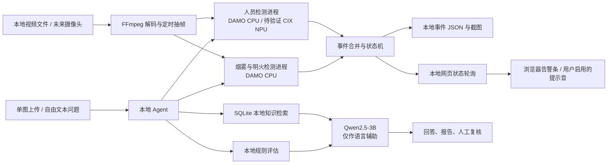

> 历史开发文档，保留原版记录；其中旧路径、版本状态和指标不作为当前交付结论。部署以仓库 README 为准，实测结论以《技术白皮书》及 benchmarks 为准。

# “应急先行”技术白皮书与 PPT 素材

版本：素材稿 v1.0  
核对日期：2026-11-22  
项目：Orange Pi / CIX P1 板端离线应急巡查原型  
用途：技术白皮书、项目汇报 PPT、现场演示讲稿

> 编写原则：区分“功能实现”“样例验证”和“现场有效性”。目前没有足够现场视频数据证明系统可承担消防报警器、消防控制系统或人工安全巡查的职责。所有演示、结论和图表应保留本文件注明的测试边界。

## 1. 项目定位

### 建议名称

**应急先行：面向断网场景的边缘端应急巡查与多模态辅助研判原型**

### 一句话介绍

在本地板卡上运行人员检测、烟火候选检测、应急知识检索和语言模型问答，并通过本地视频抽帧持续巡查，形成可复核的检测事件与证据记录。

### 项目要解决的问题

常见图片问答流程需要人员先发现情况、打开网页、上传图片并描述问题。此流程不适合发现未知事件或连续观察场景。本项目增加本地视频持续监测：后台按设定间隔取视频帧，由视觉模型直接检测人员、烟雾和明火候选；命中后保存截图、置信度和事件状态。Qwen 不位于第一时间检测链路中。

### 项目定位边界

这是**辅助巡查与研判原型**。模型输出表示候选目标，不是现场确认、火灾概率或真实火势等级。它不替代烟雾报警器、火灾自动报警系统、消防控制系统、值守人员和法定巡查程序。现场已发现烟火时，应先执行现场预案和报警，不应等待模型结果。

## 2. 当前实现状态

| 能力 | 当前实现 | 当前验证情况 |
| --- | --- | --- |
| 本地网页工作台 | Python 标准库 HTTP 服务；浏览器前端资源本地提供 | 页面及 API 测试通过 |
| 本地语言模型 | Qwen2.5-3B-Instruct，GGUF Q4_K_M，通过 llama.cpp CPU 推理 | 本机基准有记录；普通答案仍需核查 |
| 人员检测 | DAMO-YOLO 专用 person 模型，CPU | 六张样例人数与人工计数一致；不是数据集准确率 |
| 烟雾/明火检测 | DAMO-YOLO smoke/fire 模型，CPU | 少量样例做过基本推理检查；存在正样例漏检 |
| 本地知识库 | SQLite 关键词检索，保留来源和行号 | 可导入 UTF-8 文本；内容需核实版本与适用性 |
| 持续视频巡查 | FFmpeg 抽帧，后台常驻两个检测进程，页面展示最新检测帧和事件 | 静态图片拼接演示跑通；不是现场视频验证 |
| 自动事件提醒 | 首次命中建事件；第二次连续命中升级；同一类别合并；截图留存 | 状态机和前端提醒测试通过 |
| 页面声音 | 浏览器用户点击启用后播放声音 | 仅网页开着时有效；没有板端蜂鸣器或远程通知 |
| CIX YOLOv8s NPU 人员检测 | `.cix` 模型和 NOE 适配器已准备；持续监测支持独立 NOE Python 进程 | 当前配置仍是 CPU；这次环境无法访问 `/dev/aipu`，未做硬件实测 |
| CIX 烟火模型 | 尚无已验证的烟火专用 `.cix` 模型 | 未完成 ONNX 导出、CIX 编译和 NPU 验证 |
| 摄像头/RTSP | 未接入 | 没有摄像头，未做实时摄像头测试 |
| 开机自启动 | 未实现 | 网页服务退出会停止后台监测；服务重启后需重新启动监测 |

截至核对日期，相关 Python 回归测试 30 项通过，前端三组交互测试通过。这说明代码路径和模拟数据流程具备可测试性，不代表模型满足真实火灾场景的准确性、误报率或安全认证要求。

## 3. 系统架构



### 数据流说明

1. **持续监测路径**：本地视频按墙钟时间定位到最新播放位置，FFmpeg 解一帧；不将等待期间的旧帧排队，检测赶不上设定间隔时跳过已过期位置。
2. **视觉检测路径**：人员和烟火各有独立常驻子进程。这样可分别使用 DAMO CPU 环境和 NOE/CIX 环境；每帧不重新加载权重。
3. **提醒路径**：检测结果直接进入事件状态机，不等待 Qwen。Qwen 不调用在持续监测实时循环中。
4. **证据路径**：保留事件 JSON、候选类别、置信度、视频位置、事件截图和结束原因；普通预览帧只保留最近少量文件。
5. **交互问答路径**：网页上传单张图片或提交文字，由 Agent 根据问题选择检测、知识检索和规则评估，再生成辅助说明；检测失败与未检出分开表示。

## 4. 组件与配置资料

### 4.1 语言模型

- 模型：Qwen2.5-3B-Instruct。
- 量化：GGUF Q4_K_M，文件约 1.93 GB（文档约写 1.8 GiB）。
- 运行时：llama.cpp CPU，8 线程，CPU affinity `0,1,6-11`。
- 上下文：4096 tokens；最大生成：384 tokens。
- 独立基准：256 tokens 输入处理约 27.01 tokens/s；128 tokens 生成约 16.00 tokens/s；各重复两次。
- 网页工作流示例：一次本地 Web Agent 任务记录约 14.09 秒。该时间是单个任务记录，不是稳定统计值，也不是每次问答保证时延。
- 用途：自然语言问答、解释检测证据、组织建议。该模型本身不能看图；人数来自检测框，风险依据来自规则和工具结果。

### 4.2 人员模型

- CPU 模型：DAMO-YOLO `damoyolo_tinynasL25_S_person.pt`，权重约 131 MB；类别为 person。
- 输入预处理：RGB，像素值 0–255，最长边 640，stride-32 填充；坐标映射回原图。
- 置信度阈值：0.5。网页另外把 0.7 作为“重点人工复核”提示线，不从估计总数中剔除低置信度框。
- 六张样例的人工参考人数依次为 6、3、5、4、5、0；记录结果均匹配。已记录单张推理约 0.176–0.364 秒；简单均值约 0.280 秒，不含首次模型加载。
- 曾有一张 1380×920 六人图片：旧 SSD 检出 4 框，DAMO 检出 6 框。样例不包含通用目标框真值，也没有覆盖遮挡、夜间、远距离、烟雾遮挡等场景。

### 4.3 CIX YOLOv8s 候选人员模型

- 文件：`models/person/cix-yolov8s/yolov8s.cix`，约 13.4 MB。
- 来源：`cix/ai_model_hub_yolo_series`。
- 目标：CIX P1 NPU，target `X2_1204MP3`；输入 `[1,3,640,640]`，输出 `[1,84,8400]`。
- 适配器：按 COCO 80 类 YOLOv8 解码，只保留类别 `0=person`，置信度阈值 0.5，NMS 0.45。
- 预处理基于 BGR 640×640 拉伸、0–1 归一化；与官方样例预处理实现有差异，已知图像平均像素差约 1.49/255，仍须看 NPU 检测结果确认。
- 代码有独立检测入口和六样例对比脚本 `./test-person-npu.sh --activate`。需在板卡本机、`/dev/aipu` 可访问时实测；只有样例人数全匹配且重复结果稳定才自动启用。
- 当前项目 `config.json` 仍设 `person_detection.backend=damoyolo`。不能在 PPT 写成“已由 NPU 加速”或给出 NPU FPS。
- 类别范围：COCO YOLOv8s 只用于其已训练类别，项目接口只拿 person；这份权重不包含 smoke/fire。
- 许可：模型来源记录为 AGPL-3.0；对外发布前应核查模型、权重、代码与分发的许可义务。

### 4.4 烟雾与明火模型

- 模型：DAMO-YOLO TinyNAS L25-S `damoyolo_tinynasL25_S_smokefire.pt`，约 131 MB，CPU PyTorch 推理。
- 类别：fire、smoke；推理时确认名称而非照搬可能过期的类别编号。
- 输入：RGB，0–255，最长边 640，stride-32 零填充；烟火置信度阈值 0.6。
- 单张样例加载/推理路径记录约 3.9–4.0 秒，包含单独命令的模型加载成本。持续监测模型常驻后单帧耗时会低于冷启动单图时间，但实际应以当前串行/并行设置实测为准。
- 模型文件 SHA256 在 `models/fire-smoke/damoyolo-smokefire/source.json`。
- 当前为 CPU 模型。CIX 人员模型不能改名成 fire/smoke，也不能靠修改 label map 把 COCO 预训练类别变成火焰或烟雾。

### 4.5 规则与本地知识库

- 知识库：SQLite；导入 UTF-8 文本；关键词检索，报告显示来源、行号和摘录。
- 项目内条目涉及报警与撤离、初起火灾与灭火器、油锅与带电设备、特殊危险与求援、断网通信、图片预警分说明。
- 风险评估为本地规则，不代表火灾概率或真实火势等级。区间记录为 0–24、25–49、50–74、75–100，对应线索不足、疑似、高优先级、紧急优先级。该分值没有真实火势标签校准。
- 图片无法可靠判定可燃物、电源、燃气、撤离路线、烟气浓度或受训情况；“现场确认条件”必须由人勾选，模型不能自动代替现场确认。

## 5. 持续监测机制

### 5.1 当前视频验证形态

- 内置视频：`data/monitor/videos/demo.mp4`，32 秒，960×640，约 0.58 MB。
- 内容由空场负样本、人员静态样例、烟火静态样例、空场负样本拼接而成，不是连续拍摄视频。
- 抽帧间隔默认 2 秒；演示处理 16 帧。两个 CPU 检测模型热启动后，记录总周期约 0.8–1.0 秒。该值仅代表此素材与当前板端运行环境，不能作为摄像头端到端实时性能承诺。
- 没有评估真实连续视频中的动态模糊、曝光变化、火焰闪烁、压缩伪影、遮挡、视角变化和报警延迟分布。

### 5.2 事件状态

- 首次检出：立即创建“首次检出”事件并保存截图。
- 连续第二次检出：相同类别事件升级为“连续检出”；明火显示更高等级的红色提示。
- 连续三次未检出：事件结束，结束原因明确注明“这不表示现场安全”。
- 同一类别处于活动状态时合并，避免每一帧创建一条事件。
- 视频回放循环边界会重置连续命中，避免把前一周期与下一周期拼接为持续命中。
- 当前置信度阈值主要由模型设置，事件状态机没有目标跟踪器，也没有对相邻帧框 IoU 进行轨迹关联。因此事件合并是按类别的粗粒度去重，不应宣传为目标跟踪。

### 5.3 提醒与运行可靠性

- 网页轮询最新状态；用户需主动启用页面声音，浏览器策略可能要求用户手势，并且页面必须保持打开才能听到。
- 关闭网页浏览器后，后台模型进程和截图保存可继续；停止网页服务会停止监测。
- 当前没有本机蜂鸣器、GPIO、短信、电话、云推送、系统服务开机启动或进程崩溃自动恢复。
- 视频解码错误、模型异常、超时、子进程退出会进入故障状态，不应解释为“没有人员/烟火”。
- 安全场景需额外评估硬件断电、系统崩溃、磁盘满、温度降频、摄像头断流和异常静帧。当前软件状态页还不构成经认证的失效安全链路。

## 6. 已有验证结果与可引用范围

### 6.1 可以准确引用的结果

1. **功能链路**：网页单图问答、本地模型工具调用、本地知识查询、事件记录与报告路径有实现；相关自动化测试可通过。
2. **人员样例**：六张图片上的检测人数与人工点数相同；表述为“六张选定样例人数均匹配”，不得表述为“人数准确率 100%”。样例没有逐框真值，无法算 precision/recall/mAP。
3. **烟火样例**：4 张基础样例记录中，3 张人工标注为烟火正例，只有 1 张同时检出 fire 和 smoke；2 张正样例未检出。另有用户图片 `fire_000004.jpg` 在 0.6 阈值下漏检记录。
4. **持续流程**：静态图片拼接演示中，持续监测代码处理 16 帧，产生人员、烟雾和明火事件，证明抽帧、状态升级、保存截图的工程流程跑通。
5. **CPU 周期**：上述演示的稳定阶段周期约 0.8–1.0 秒；场景不是自然视频，不包含摄像头捕获时间。
6. **Qwen 基准**：256 tokens 输入约 27 tokens/s、128 tokens 生成约 16 tokens/s，各两次；这是短输入/独立命令基准。
7. **软件检查**：2026-11-22 核对时，30 项相关 Python 测试通过，三组前端交互测试通过。
8. **NPU 状态**：`.cix` 文件与 SHA256 清单匹配；但当次执行环境没有 `/dev/aipu`，NPU 对比报告为 blocked。文件存在不等于硬件推理通过。

### 6.2 不要引用的说法

- “火灾识别准确率 100% / 90% / 95%”。当前没有合格、分场景标注的独立测试集。
- “零漏报”“保证安全”“能替代报警器或人工值守”。已有正样例漏检直接否定此类说法。
- “实时视频 30 FPS”或“2 秒必然报警”。只有本地静态图片序列的抽帧测试，且系统按 2 秒间隔采样。
- “AI 已经在 CIX NPU 上运行”。当前配置是 DAMO CPU；此会话没有 NPU 运行证据。
- “Qwen 能看懂现场图片”。当前 Qwen 为文本模型，图像目标由专用视觉检测器提取。
- “图片预警 90 分表示火灾概率 90%”。分数是未校准规则值，不是概率。

## 7. 白皮书建议结构与可用正文

### 摘要（可直接改写）

本文介绍“应急先行”板端离线巡查原型。系统以 Orange Pi/CIX P1 类 ARM64 边缘设备为运行目标，将本地语言模型、专用人员与烟火检测模型、SQLite 知识检索和规则评估组合在一个不依赖公网 API 的流程中。除单图上传和文本问答外，系统增加本地视频持续监测：后台按固定间隔解码最新帧，检测模型直接触发事件、保存截图并由网页展示。语言模型不参与持续检测的第一时间报警链路。现有工程验证包括人员样例人数对比、少量烟火样例推理、静态图片序列监测以及软件接口回归测试。烟火模型已记录正样例漏检，CIX 人员模型尚待板端 NPU 实测，系统也尚未进行真实摄像头的独立现场评估。因此，本系统定位为断网环境下的巡查辅助原型，不替代正式报警设施或人工安全职责。

### 1. 引言建议要点

- 传统手动图像问答是“人先发现、再上传”，响应步骤多。
- 离线场景可能缺少公网、云 API 或稳定链路，需要边缘端处理与本地留存。
- 本项目将交互式复核与后台持续抽帧分开：前者由人触发，后者主动巡查。
- 工程目标是提高可用性、证据留存与本地自治，不宣称替代消防系统。

### 2. 需求与设计目标

- 断网下运行；模型和依赖提前安装到本地。
- 浏览器能提交图片与问题，并查看工具步骤、状态、证据和报告。
- 持续监测不依赖用户每次手动上传图片。
- 检测失败、未执行和成功未检出三种状态必须不同。
- 优先在本地保存数据，记录模型版本、检测类别、置信度和人工复核。
- 视觉提示不经生成模型改写为“已确认事实”。

### 3. 系统方法

- 介绍 CPU 模型、候选 CIX 模型、FFmpeg 抽帧、跨环境子进程、SQLite、事件 JSON。
- 明确输入输出：帧时间/图像尺寸 → `{label, confidence, box}` → 事件状态 → 截图与页面提醒。
- 说明规则分数为内部启发式排序，不是概率；人机边界由现场确认控件和报告状态表达。
- 说明对话内缓存按图片 SHA256、模型配置和模型文件指纹校验，避免串用不同图像的检测结果。

### 4. 实验设计（后续正式评估建议）

正式白皮书应补充独立数据集，按**地点/视频源/日期**切分，避免相邻帧泄漏到训练和测试两侧；至少覆盖白天、夜间、逆光、远距离、小火、烟雾、蒸汽/灰尘负例、焊接/厨房/车辆灯光等混淆场景。人工标注人员框、fire/smoke 框、事件起止时间与可见性；双人复核标注分歧。保留完全未参与阈值调整的测试集。

建议指标：

- 检测层：按类别 precision、recall、F1、AP50/mAP50-95；说明置信度阈值和 IoU 标注规则。
- 事件层：事件召回率、每小时误报事件数、首次可见到首次提醒的延迟、持续命中升级延迟、重复事件合并率。
- 运行层：冷启动时间、热态帧处理 P50/P95、实际检测帧间隔、CPU/NPU 占用、内存、温度、功耗、掉帧数、稳定运行时长。
- 人因层：操作步骤数、提醒是否被察觉、误报后的处理负担；需伦理和现场安全审查。
- 对比层：DAMO CPU 与 CIX NPU 同图对比；检查图像预处理差异导致的框、置信度和漏检变化。

建议报告混淆矩阵，并分别列出“文件级识别”和“事件级识别”；连续视频的相邻帧不能当成独立样本扩大样本量。

### 5. 安全与局限

- 正样例漏检说明视觉模型有盲区，连续采样只能提高再次观察机会，不能保证捕捉或识别。
- 未检出不是现场安全；模型报警也不是火情确认。
- 页面提示音不是独立报警器；浏览器关闭、静音、系统休眠或音频策略会造成声音不可达。
- 目前没有摄像头，故没有真实流的延迟、稳定性和误报数据。
- 烟火模型仍用 CPU；人员 NPU 尚未验证。
- 语言模型可能给出错误或不完整建议，应使用经审核预案并由人员判断。
- 本地存储要考虑权限、保留时长、磁盘满、敏感图像处理和删除策略。
- 法规、许可、模型许可、消防规范和实际场地审批需另行审查。

### 6. 结论建议

目前已完成离线软件原型、单图人机复核流程和基于本地视频的持续抽帧工程验证。下一阶段优先事项不是增加语言模型轮次，而是接入摄像头或真实视频、建立按场景独立标注的评估集、降低烟火漏检和误报，并完成 CIX NPU 板端基准、断流故障监测和独立硬件提醒验证。

## 8. PPT 建议：14 页内容与讲述

### 第 1 页｜标题

**应急先行：断网环境下的边缘端智能巡查原型**  
副标题：本地检测 · 持续抽帧 · 证据留存  
画面：板卡 + 本地流程界面/真实设备照片。若没有实拍板子或相机，标注为“软件原型界面”，不要伪装成实际部署现场。

### 第 2 页｜现场痛点

- 手动上传流程：发现 → 打开网页 → 拍照/选图 → 输入问题 → 等待分析。
- 未知事件需要系统主动观察，而不是只响应用户提问。
- 断网时云端 API 不可用；事件证据也需要留在本地。

讲稿：我们保留人工复核入口，同时增加后台持续抽帧，缩短“发现未知情况”时的操作链路。

### 第 3 页｜目标与边界

左侧列目标：离线推理、持续巡查、自动形成候选提醒、留存证据。右侧列边界：原型、未接真实摄像头、尚无现场准确率结论、不替代消防设施。

讲稿：项目要验证工程链路和边缘部署可行性，而不是宣称已经达到消防报警器的可靠性。

### 第 4 页｜系统总体架构

使用本文件 Mermaid 图重绘。突出“两条链路”：持续监测的视觉快速链路，以及用户触发的 Agent/Qwen 解释链路。图中明确 Qwen 不阻塞实时提醒。

### 第 5 页｜端侧技术栈

| 层 | 技术 |
| --- | --- |
| 用户界面 | 本地 HTML/CSS/JavaScript |
| Web 服务/任务 API | Python 标准库 HTTPServer |
| 视频解码和抽帧 | FFmpeg/FFprobe |
| 人员与烟火 | DAMO-YOLO PyTorch CPU，独立进程 |
| 语言问答 | Qwen2.5-3B GGUF / llama.cpp CPU |
| 知识和报告 | SQLite、JSON、Markdown、HTML |
| NPU 候选 | CIX YOLOv8s `.cix`，待硬件测量 |

### 第 6 页｜持续监测工作流

展示：视频输入 → 每 2 秒定位/抽帧 → 两个常驻模型并行处理 → 事件状态机 → 页面提醒与截图。标注当前显示最新检测帧，不是直播流。

### 第 7 页｜事件状态与证据

状态示意：首次命中 → 第二次连续命中升级 → 三次未检出后结束；同类事件合并。展示一张演示截图和事件 JSON 字段：类别、置信度、视频位置、首次/最后时间、截图链接。

讲稿：状态机按类别做事件去重，不是跨帧目标跟踪；结束事件不表示现场安全。

### 第 8 页｜端侧模型

分成三个模块卡：

- 人员：DAMO-YOLO person，CPU，RGB 0–255，最大边 640，阈值 0.5。
- 烟火：DAMO-YOLO fire/smoke，CPU，RGB 0–255，最大边 640，阈值 0.6。
- Qwen：Qwen2.5-3B-Instruct，GGUF Q4_K_M，CPU，4096 context。

侧栏注明“人员 CIX YOLOv8s 仍为待验证候选”；不要把其标成已运行 NPU。

### 第 9 页｜本地 Agent 如何分工

显示问答 Agent 可选择人员检测、烟火检测、知识检索、规则评估；检测结果是人数/候选类别，语言模型负责组织文字。工具失败不等于零检测，报告保留实际执行状态。

### 第 10 页｜样例验证：人员

展示六个样例的人数表：`6/6、3/3、5/5、4/4、5/5、0/0`。脚注：选定样例；人工点数；没有逐框真值；不得推导准确率/mAP。CPU 单图热态记录 0.176–0.364 秒，约 0.280 秒均值；不含模型加载。

### 第 11 页｜样例验证：烟火与局限

展示正例 3 张，双类火/烟都检出的正例 1 张、正样例未检出 2 张；另有 1 张普通场景负例未检出烟火。另列用户图 `fire_000004.jpg` 漏检案例。脚注：样本很少且非独立现场评估；不能计算正式性能指标。

讲稿：这页要主动呈现漏检，是当前模型可用性判断的重要证据。

### 第 12 页｜持续流程演示

演示视频：32 秒由静态图片拼接，按 2 秒抽帧，处理 16 帧，检出人员、烟雾、明火事件；稳定周期约 0.8–1.0 秒。醒目标注“静态序列工程演示，不是真实监控视频性能”。

### 第 13 页｜CIX NPU 路线

已备模型：YOLOv8s `.cix`，输入 `[1,3,640,640]`、输出 `[1,84,8400]`、COCO person 类。下一步：板端运行 `test-person-npu.sh --activate`，六图三次重复验证；随后评估烟火模型 ONNX 导出、x86/Python3.10 CIX 编译、校准与板端结果对齐。状态：当前配置仍 CPU，`/dev/aipu` 尚未在本次验证环境可见。

### 第 14 页｜路线图与结论

1. 接入真实 USB/RTSP 摄像头，完成权限与断流状态。
2. 建立按场景/视频源切分、双人标注的烟火和人员测试集。
3. 报告 recall、每小时误报、事件延迟和 P95 帧周期。
4. 板端验证 CIX 人员检测；评估烟火模型转换/训练。
5. 增加独立硬件声光提醒、开机服务、看门狗、磁盘保留策略。
6. 在现场人员和安全规范审查后再谈试点部署。

结束语：**目前证明了端侧离线软件链路能够运行；真实现场效果和 NPU 性能仍需测试。**

## 9. 图表与演示素材清单

- 系统架构图：本文件 Mermaid 图。
- 人员框图：`data/person_detection_validation.json` 关联原图；使用报告或脚本输出的框图，注明人工人数参考。
- 烟火框图：`samples/fire-smoke/ESE_fire_10.jpg`；模型检出 smoke 0.838、fire 0.692，阈值 0.6。
- 漏检图：`samples/fire-smoke/ESE_fire_1.jpg`、`ESE_fire_100.jpg`，人工检查为正例但当前模型未检出。
- 持续监测演示：`data/monitor/videos/demo.mp4`；标注“静态图片序列”。
- CIX 模型卡片：`models/person/cix-yolov8s/source.json`；注明“待 NPU 实测”。
- Qwen 性能记录：`data/llm_upgrade_qwen3b.json` 和 `/home/orangepi/models/qwen2.5-3b/benchmark.json`。
- 烟火评估样例记录：`data/fire_smoke_validation.json`。
- 人员样例记录：`data/person_detection_validation.json`。
- NPU 阻塞记录：`data/person_npu_comparison.json`。

制图时不要把测试图片拼成一张后称为“实际监控画面”；不要把程序规则评分画成概率仪表盘；不要把 YOLO 的 person 框或 COCO 预训练能力说成火灾识别。

## 10. 推荐的后续实验记录模板

每条实验至少保存：

```text
实验编号：
板卡型号 / 系统版本 / 内核：
模型文件 SHA256 / 类别表 / 运行时版本：
CPU affinity / NPU 设备 / 温度 / 功耗：
视频来源、场景、分辨率、帧率、时长：
抽帧间隔与抽帧位置：
标注规则、标注员、复核方式：
置信度阈值、NMS/IoU 阈值：
每类 TP / FP / FN，precision / recall / F1：
事件级 recall、每小时误报数、P50/P95 报警延迟：
热态帧周期 P50/P95、掉帧数、内存、稳定运行小时数：
失败、断流、异常静帧、磁盘满等故障测试：
结论范围与未验证项：
```
